# Population Report – Results

Below are the results produced by each report when the project is run.

---

---

## US01 – All Countries in the World by Population

Lists every country in the world (Country Name, Continent, Region, Population), sorted from largest to smallest population.

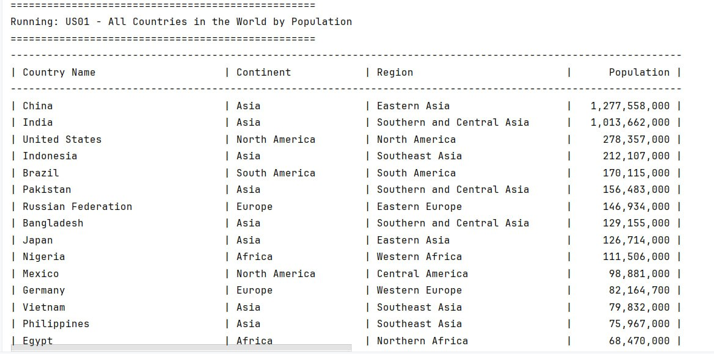

---

## US02 – Countries Grouped by Continent

Lists countries grouped by continent, with each group sorted by population from largest to smallest. (Example shown: Asia)

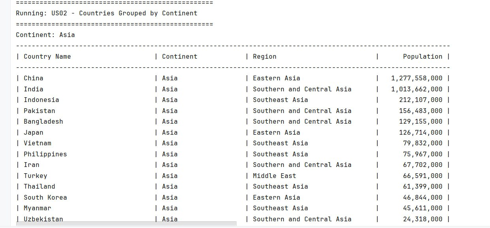

---

## US03 – All Countries in a Region

Lists all countries in each region with Code, Country, Continent, Region, Population and Capital. (Examples shown: Antarctica, Australia and New Zealand)

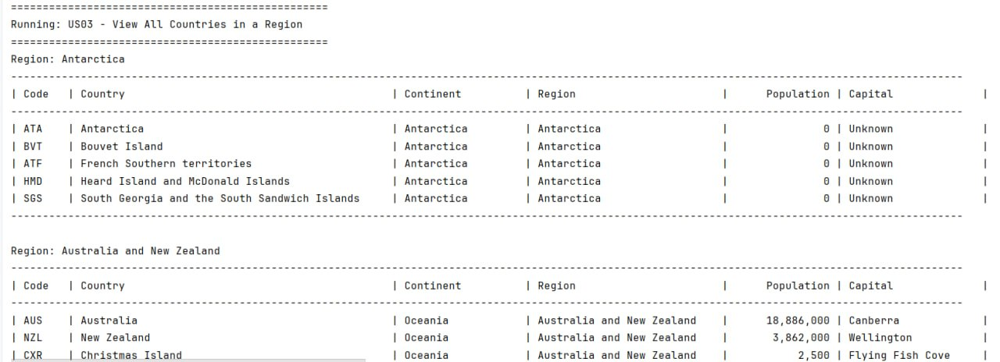

---

## US07 – All Cities in the World

Lists every city in the world (City Name, Country, District, Population), sorted from largest to smallest population.

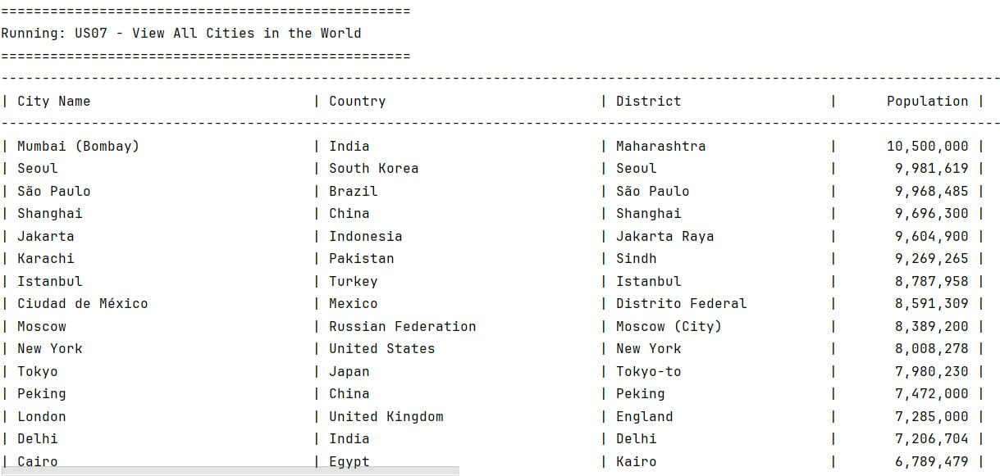

---

## US08 – All Cities in a Continent

Lists all cities in a chosen continent, sorted by population from largest to smallest. (Example shown: Asia)

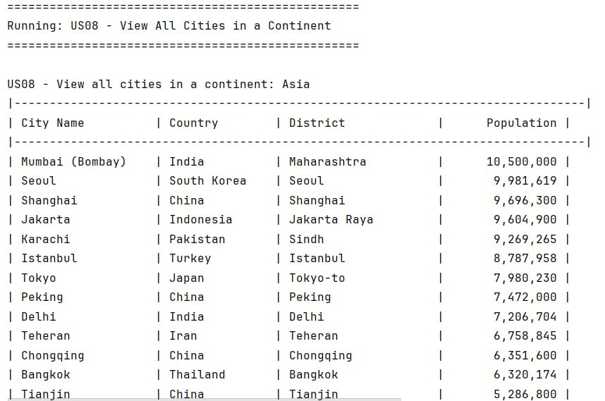

---

## US09 – All Cities in a Region

Lists all cities in a chosen region, sorted by population from largest to smallest. (Example shown: Southeast Asia)

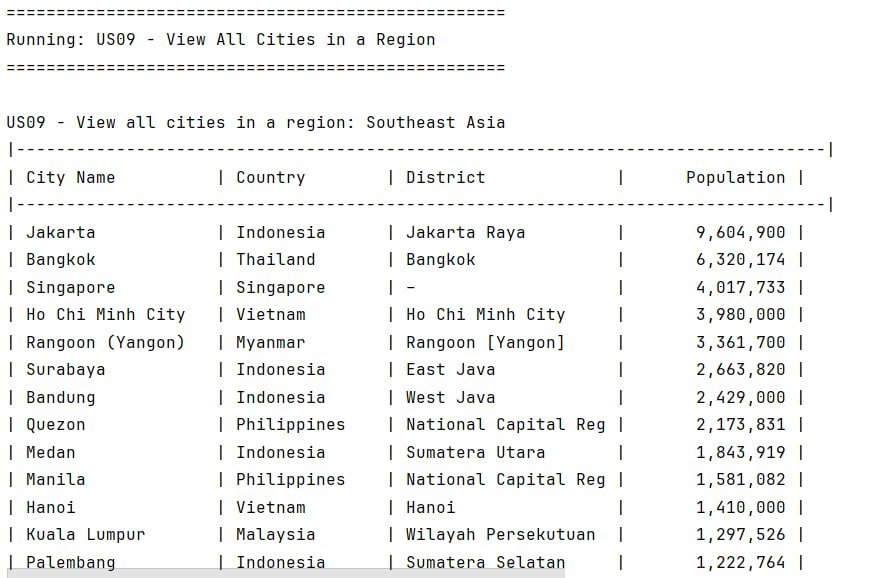

---

## US13 – Top Populated Cities in a Continent

Shows the 10 most populated cities in a chosen continent. (Example shown: Asia)

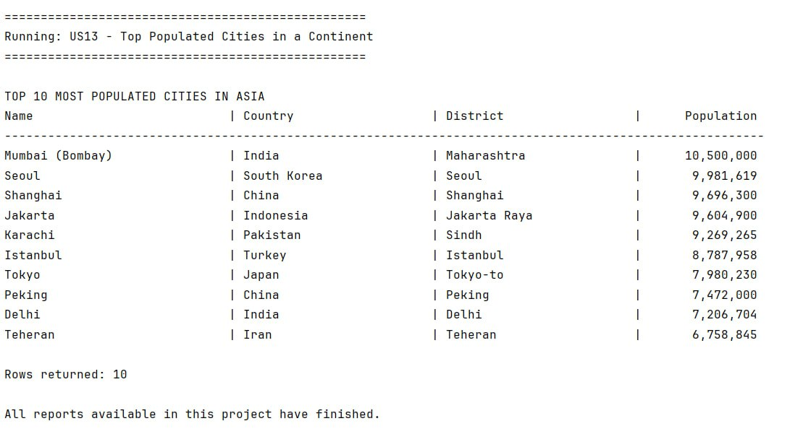

---

## US14 – Top Populated Cities in a Region

Shows the 10 most populated cities in a chosen region. (Example shown: Southeast Asia)

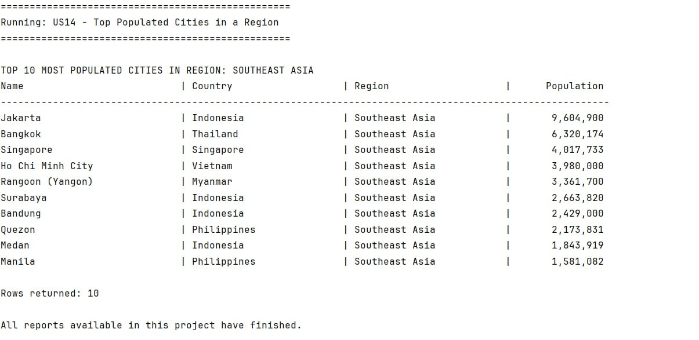

---

## US15 – Top Populated Cities in a Country

Shows the 10 most populated cities in a chosen country. (Example shown: Japan)

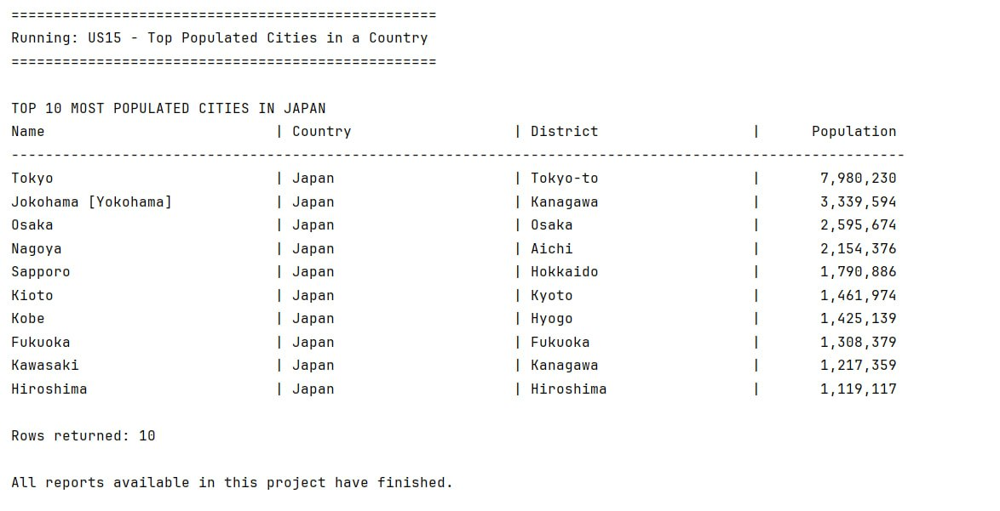

---

## US17 – All Capital Cities in the World

Lists every capital city in the world (Capital City, Country, Population), sorted from largest to smallest population.

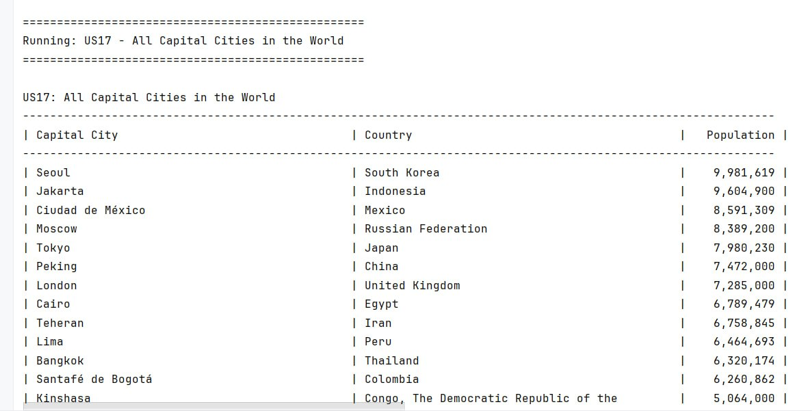

---

## US18 – Capital Cities by Continent

Lists all capital cities in a chosen continent, sorted by population from largest to smallest. (Example shown: Europe)

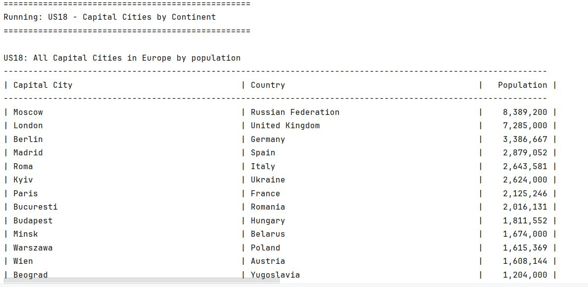

---

## US19 – Capital Cities by Region

Lists all capital cities in a chosen region, sorted by population from largest to smallest. (Example shown: Caribbean)

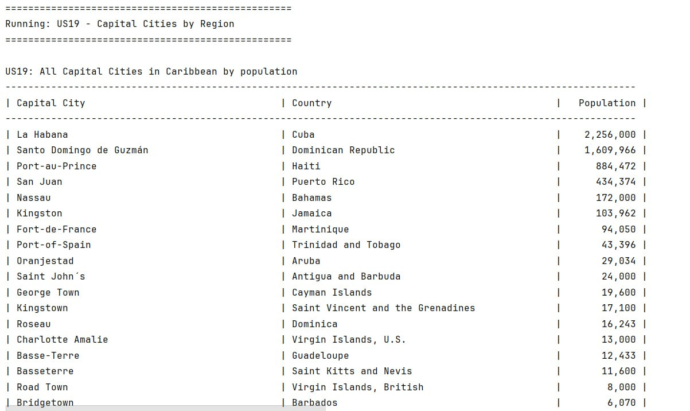

---

## US25 – Population by Country

Compares each country's total population with its city population (City %) and non-city population (Non-City %).

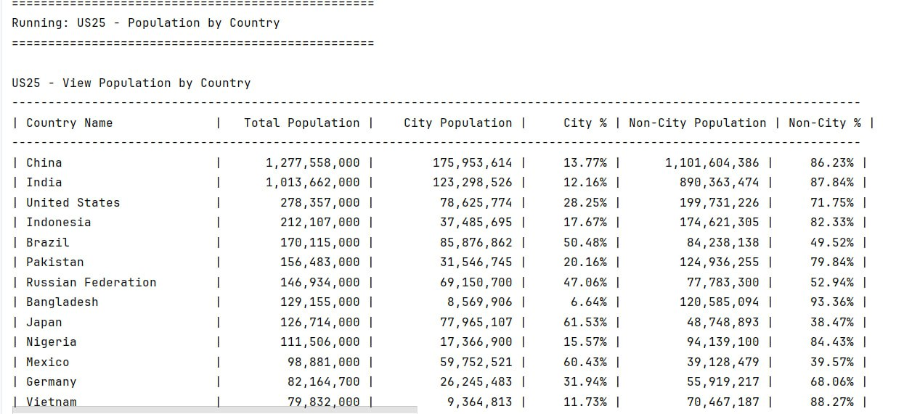

---

## US26 – Total World Population

Shows the total world population (6,078,749,450) and the number of countries included in the calculation (239).

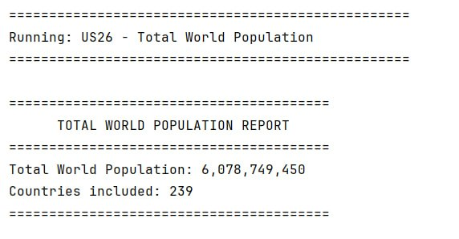

---

## US29 - Country Population Report

Shows the total population of each country, sorted from largest to smallest.

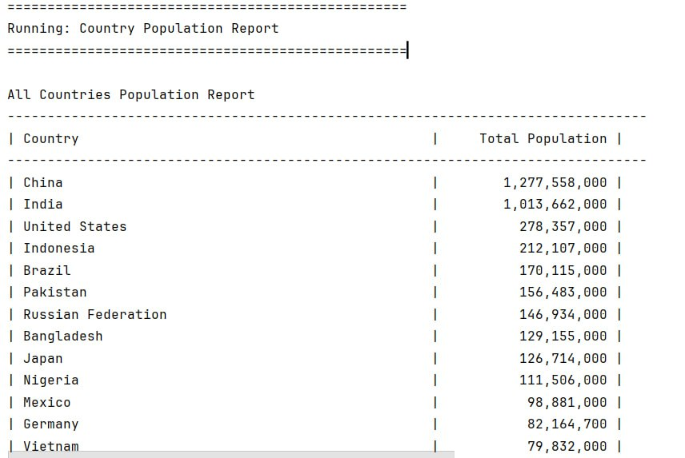

## US30 - District Population Report

Shows the total population of each district, sorted from largest to smallest.

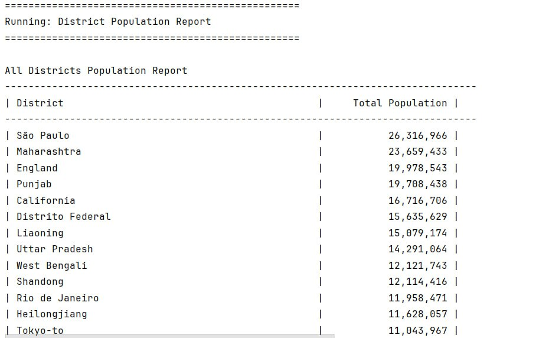
