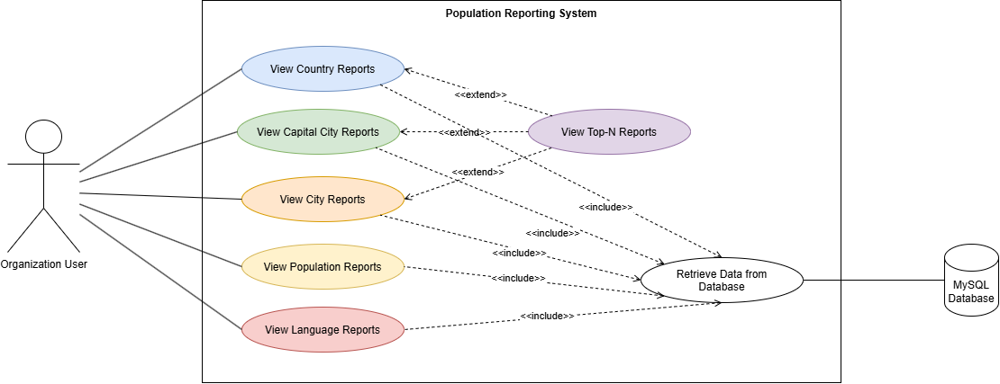

# Population Reporting System - Use Case Documentation

## 1. Introduction

The Population Reporting System retrieves, processes, and presents population information from a MySQL database. It enables an Organization User to generate reports about countries, cities, capital cities, population figures, and language speakers.

The system is designed to provide accurate, clearly structured, and easy-to-understand reports. It supports comparisons across geographical levels and allows users to identify the most populated countries, cities, and capital cities.

This document defines the functional behavior of the system through **32 use cases**, grouped into **six main categories** that match the Use Case Diagram. Each use case describes the actor, goal, preconditions, trigger, main success flow, alternative or exception flows, and postconditions.

### 1.1 Primary Actor

**Organization User:** The person who accesses the system to request and view population reports.

### 1.2 External System

**MySQL Database:** Provides the underlying country, city, population, and language data required to generate the reports.

### 1.3 System Boundary

The Population Reporting System includes report selection, input validation, database retrieval, population calculations, result sorting, report presentation, and error handling.

### 1.4 Scope

The system provides six categories of reports:

1. Country Reports
2. City Reports
3. Capital City Reports
4. Top-N Reports
5. Population Reports
6. Language Reports

---

## 2. Use Case Diagram

[Open the editable Use Case Diagram](Population_Reporting_System_Use_Case.drawio)

### 2.1 Use Case Diagram Summary

The diagram shows the interaction between the Organization User and the Population Reporting System. The system contains six main report categories:

- **View Country Reports**
- **View City Reports**
- **View Capital City Reports**
- **View Top-N Reports**
- **View Population Reports**
- **View Language Reports**

The diagram also contains the supporting use case **Retrieve Data from Database**, which connects the system to the external **MySQL Database**.

- The Organization User is associated with the five main report categories: Country, Capital City, City, Population, and Language Reports.
- **View Top-N Reports** extends View Country Reports, View Capital City Reports, and View City Reports. It adds a Top-N limit to those reports.
- Each of the five main report categories **includes** Retrieve Data from Database, because every report needs data from the MySQL Database.

The 32 detailed use cases below are divided among these six categories.

### 2.2 Diagram Relationships

| Relationship | From | To | Meaning |
|---|---|---|---|
| Association | Organization User | View Country Reports | The user requests country reports. |
| Association | Organization User | View Capital City Reports | The user requests capital city reports. |
| Association | Organization User | View City Reports | The user requests city reports. |
| Association | Organization User | View Population Reports | The user requests population reports. |
| Association | Organization User | View Language Reports | The user requests language reports. |
| Extend | View Top-N Reports | View Country Reports | Limits country reports to the top N records. |
| Extend | View Top-N Reports | View Capital City Reports | Limits capital city reports to the top N records. |
| Extend | View Top-N Reports | View City Reports | Limits city reports to the top N records. |
| Include | Country, Capital City, City, Population, Language Reports | Retrieve Data from Database | Every report retrieves its data from the database. |
| Association | Retrieve Data from Database | MySQL Database | Data is read from the MySQL database. |

### 2.3 Included Use Case: Retrieve Data from Database

Retrieve Data from Database is a shared supporting behavior included by all report categories. It is not counted among the 32 reporting use cases.

- **Purpose:** Connect to the MySQL Database, run the query required by the selected report, and return the result to the calling report.
- **Failure handling:** If the connection or query fails, the system shows an error message without exposing credentials or SQL internals.

### 2.4 Use Case Distribution

| Category | Use Case IDs | Count |
|---|---|---|
| Country Reports | UC01, UC02, UC03 | 3 |
| City Reports | UC07, UC08, UC09, UC10, UC11 | 5 |
| Capital City Reports | UC17, UC18, UC19 | 3 |
| Top-N Reports | UC04, UC05, UC06, UC12, UC13, UC14, UC15, UC16, UC20, UC21, UC22 | 11 |
| Population Reports | UC23, UC24, UC25, UC26, UC27, UC28, UC29, UC30, UC31 | 9 |
| Language Reports | UC32 | 1 |
| **Total** | UC01-UC32 | **32** |

---

## 3. Use Case Description Format

Each use case follows a consistent structure:

- **Use Case ID and Name:** A unique identifier and descriptive title.
- **Category:** The diagram category the use case belongs to.
- **Primary Actor:** The person initiating the interaction.
- **Goal:** The outcome the actor wants to achieve.
- **Preconditions:** Conditions that must be satisfied before execution.
- **Trigger:** The action that initiates the use case.
- **Main Success Flow:** The normal sequence of interactions.
- **Alternative and Exception Flows:** Handling of invalid input, missing data, empty results, and system failures.
- **Postconditions:** The state or result after execution.

### 3.1 General Assumptions

- The Organization User can access the report functions provided by the application.
- The MySQL Database contains the data required by the requested report.
- Geographic classifications and report fields follow the database schema.
- Reports requiring a Top N value accept a positive integer.
- Population totals and percentages are calculated using clearly defined data and formulas.
- The system distinguishes between an empty result and a database or processing error.
- Results are sorted in descending order when the most populated records must appear first.
- Unavailable data or unsupported calculations are reported rather than shown as confirmed values.
- Every use case includes **Retrieve Data from Database**.

---

## 4. Country Reports

**Diagram use case:** View Country Reports (includes Retrieve Data from Database; extended by View Top-N Reports)

### UC01 - All Countries in the World

- **Primary Actor:** Organization User
- **Goal:** Display all available countries ordered by population from highest to lowest.
- **Preconditions:** The application can access the database. Country records are available.
- **Trigger:** The user selects the All Countries report.

**Main Success Flow:**
1. The user requests the All Countries report.
2. The system retrieves the available country records.
3. The system obtains the code, name, continent, region, population, and capital where available.
4. The system sorts the records by population in descending order.
5. The system displays the report.

**Alternative and Exception Flows:**
- If no country records are available, the system displays a no-data message.
- If a country has missing information, the system handles the missing value appropriately.
- If the database connection or query fails, the system displays an error message.

**Postconditions:** The country report is displayed in the required order, or a message explains why it cannot be generated.

### UC02 - Countries by Continent

- **Primary Actor:** Organization User
- **Goal:** Display countries in a selected continent, ordered by population from highest to lowest.
- **Preconditions:** Country and continent data are available. The database is accessible.
- **Trigger:** The user selects the Countries by Continent report.

**Main Success Flow:**
1. The user requests the report.
2. The system presents the available continents.
3. The user selects a continent.
4. The system retrieves countries belonging to that continent.
5. The system sorts the countries by population in descending order.
6. The system displays the country details.

**Alternative and Exception Flows:**
- If the user does not select a valid continent, the system requests a valid selection.
- If no countries match the continent, the system displays a no-data message.
- If a database error occurs, the system reports the failure.

**Postconditions:** The matching countries are displayed in descending population order, or the user receives an appropriate message.

### UC03 - Countries by Region

- **Primary Actor:** Organization User
- **Goal:** Display countries in a selected region, ordered by population from highest to lowest.
- **Preconditions:** Country and region data are available. The database is accessible.
- **Trigger:** The user selects the Countries by Region report.

**Main Success Flow:**
1. The user requests the report.
2. The system presents the available regions.
3. The user selects a region.
4. The system retrieves countries belonging to that region.
5. The system sorts the results by population in descending order.
6. The system displays the country details.

**Alternative and Exception Flows:**
- If the selected region is invalid, the system requests a valid selection.
- If no countries match the region, the system displays a no-data message.
- If a database error occurs, the system displays an error message.

**Postconditions:** The countries in the selected region are displayed in the required order, or an appropriate message is provided.

---

## 5. City Reports

**Diagram use case:** View City Reports (includes Retrieve Data from Database; extended by View Top-N Reports)

### UC07 - All Cities in the World

- **Primary Actor:** Organization User
- **Goal:** Display all available cities worldwide, ordered by population from highest to lowest.
- **Preconditions:** City and country records are available.
- **Trigger:** The user selects the All Cities report.

**Main Success Flow:**
1. The user requests the report.
2. The system retrieves city records and their associated country information.
3. The system obtains the city name, country, district, and population where available.
4. The system sorts the cities by population in descending order.
5. The system displays the report.

**Alternative and Exception Flows:**
- If no city records are available, the system displays a no-data message.
- If optional city information is missing, the system handles it appropriately.
- If a database error occurs, the system displays an error message.

**Postconditions:** All available city records are displayed in the required order.

### UC08 - Cities by Continent

- **Primary Actor:** Organization User
- **Goal:** Display cities in a selected continent, ordered by population from highest to lowest.
- **Preconditions:** City, country, and continent data are available.
- **Trigger:** The user selects the Cities by Continent report.

**Main Success Flow:**
1. The user requests the report.
2. The system presents the available continents.
3. The user selects a continent.
4. The system retrieves cities belonging to countries in that continent.
5. The system sorts the cities by population in descending order.
6. The system displays the matching cities.

**Alternative and Exception Flows:**
- If the continent selection is invalid, the system requests a valid selection.
- If no cities match the selection, the system displays a no-data message.
- If a database error occurs, the system reports the failure.

**Postconditions:** Cities in the selected continent are displayed in the required order.

### UC09 - Cities by Region

- **Primary Actor:** Organization User
- **Goal:** Display cities in a selected region, ordered by population from highest to lowest.
- **Preconditions:** City, country, and region data are available.
- **Trigger:** The user selects the Cities by Region report.

**Main Success Flow:**
1. The user requests the report.
2. The system presents the available regions.
3. The user selects a region.
4. The system retrieves cities belonging to countries in that region.
5. The system sorts the cities by population in descending order.
6. The system displays the matching city details.

**Alternative and Exception Flows:**
- If the region selection is invalid, the system requests a valid selection.
- If no cities match the region, the system displays a no-data message.
- If a database error occurs, the system displays an error message.

**Postconditions:** Cities in the selected region are displayed in the required order.

### UC10 - Cities by Country

- **Primary Actor:** Organization User
- **Goal:** Display cities in a selected country, ordered by population from highest to lowest.
- **Preconditions:** City and country data are available.
- **Trigger:** The user selects the Cities by Country report.

**Main Success Flow:**
1. The user requests the report.
2. The system presents the available countries.
3. The user selects a country.
4. The system retrieves cities associated with that country.
5. The system sorts the results by population in descending order.
6. The system displays the city name, country, district, and population where available.

**Alternative and Exception Flows:**
- If the country selection is invalid, the system requests a valid selection.
- If the country has no matching city records, the system displays a no-data message.
- If a database error occurs, the system displays an error message.

**Postconditions:** Cities in the selected country are displayed in descending population order.

### UC11 - Cities by District

- **Primary Actor:** Organization User
- **Goal:** Display cities in a selected district, ordered by population from highest to lowest.
- **Preconditions:** City and district data are available.
- **Trigger:** The user selects the Cities by District report.

**Main Success Flow:**
1. The user requests the report.
2. The system presents available districts or requests a district value.
3. The user selects or enters a district.
4. The system validates the district selection.
5. The system retrieves matching city records.
6. The system sorts the cities by population in descending order.
7. The system displays the matching cities.

**Alternative and Exception Flows:**
- If the district value is invalid or empty, the system requests a valid value.
- If no cities match the district, the system displays a no-data message.
- If a database error occurs, the system displays an error message.

**Postconditions:** The matching cities are displayed in descending population order.

---

## 6. Capital City Reports

**Diagram use case:** View Capital City Reports (includes Retrieve Data from Database; extended by View Top-N Reports)

### UC17 - All Capital Cities in the World

- **Primary Actor:** Organization User
- **Goal:** Display all available capital cities worldwide, ordered by population from highest to lowest.
- **Preconditions:** Country records, capital city references, and city population data are available.
- **Trigger:** The user selects the All Capital Cities report.

**Main Success Flow:**
1. The user requests the report.
2. The system identifies capital cities using the country-to-capital relationship in the database.
3. The system retrieves the capital city name, country name, and city population.
4. The system sorts the results by population in descending order.
5. The system displays the report.

**Alternative and Exception Flows:**
- If no valid capital city records are available, the system displays a no-data message.
- If a country has no valid capital city reference, that record is handled according to the reporting requirements.
- If a database error occurs, the system displays an error message.

**Postconditions:** Available capital city records are displayed in descending population order.

### UC18 - Capital Cities by Continent

- **Primary Actor:** Organization User
- **Goal:** Display capital cities in a selected continent, ordered by population from highest to lowest.
- **Preconditions:** Country, continent, capital city, and population data are available.
- **Trigger:** The user selects the Capital Cities by Continent report.

**Main Success Flow:**
1. The user requests the report.
2. The system presents the available continents.
3. The user selects a continent.
4. The system retrieves capital cities belonging to countries in that continent.
5. The system sorts the results by capital city population in descending order.
6. The system displays the capital city and country details.

**Alternative and Exception Flows:**
- If the continent is invalid, the system requests a valid selection.
- If no capital cities match the continent, the system displays a no-data message.
- If a database error occurs, the system displays an error message.

**Postconditions:** Capital cities in the selected continent are displayed in the required order.

### UC19 - Capital Cities by Region

- **Primary Actor:** Organization User
- **Goal:** Display capital cities in a selected region, ordered by population from highest to lowest.
- **Preconditions:** Country, region, capital city, and population data are available.
- **Trigger:** The user selects the Capital Cities by Region report.

**Main Success Flow:**
1. The user requests the report.
2. The system presents the available regions.
3. The user selects a region.
4. The system retrieves capital cities belonging to countries in that region.
5. The system sorts the results by population in descending order.
6. The system displays the capital city and country details.

**Alternative and Exception Flows:**
- If the region is invalid, the system requests a valid selection.
- If no capital cities match the region, the system displays a no-data message.
- If a database error occurs, the system displays an error message.

**Postconditions:** Capital cities in the selected region are displayed in descending population order.

---

## 7. Top-N Reports

**Diagram use case:** View Top-N Reports. It **extends** View Country Reports, View City Reports, and View Capital City Reports by limiting the result to the N most populated records.

**Common rules for all Top-N use cases:**
- The user supplies N as a positive integer.
- If N is missing, zero, negative, or not an integer, the system requests a valid value.
- If fewer than N eligible records exist, the system displays all available records.
- If no eligible records exist, the system displays a no-data message.
- If a database error occurs, the system displays an error message.

### 7.1 Top-N Country Reports (extends View Country Reports)

#### UC04 - Top N Populated Countries in the World

- **Primary Actor:** Organization User
- **Goal:** Display the N most populated countries worldwide.
- **Preconditions:** Country population data are available.
- **Trigger:** The user selects the Top N Countries in the World report.

**Main Success Flow:**
1. The user requests the report.
2. The system requests N.
3. The user enters a positive integer.
4. The system retrieves country records with valid population values.
5. The system sorts the records by population in descending order.
6. The system selects up to N records.
7. The system displays the selected countries and their required details.

**Postconditions:** The requested number of highest-population countries, or all eligible records when fewer are available, is displayed.

#### UC05 - Top N Populated Countries in a Continent

- **Primary Actor:** Organization User
- **Goal:** Display the N most populated countries in a selected continent.
- **Preconditions:** Country, continent, and population data are available.
- **Trigger:** The user selects the Top N Countries by Continent report.

**Main Success Flow:**
1. The user requests the report.
2. The system asks the user to select a continent and enter N.
3. The user provides both values.
4. The system validates the selection and N.
5. The system retrieves eligible countries in the selected continent.
6. The system sorts the results by population in descending order.
7. The system selects up to N countries and displays their details.

**Additional Alternative Flow:** If the continent is invalid, the system requests a valid selection.

**Postconditions:** The top N eligible countries in the selected continent are displayed.

#### UC06 - Top N Populated Countries in a Region

- **Primary Actor:** Organization User
- **Goal:** Display the N most populated countries in a selected region.
- **Preconditions:** Country, region, and population data are available.
- **Trigger:** The user selects the Top N Countries by Region report.

**Main Success Flow:**
1. The user requests the report.
2. The system asks the user to select a region and enter N.
3. The user provides the required values.
4. The system validates the input.
5. The system retrieves eligible countries in the selected region.
6. The system sorts the results by population in descending order.
7. The system selects up to N countries and displays the report.

**Additional Alternative Flow:** If the region is invalid, the system requests a valid selection.

**Postconditions:** The top N eligible countries in the selected region are displayed.

### 7.2 Top-N City Reports (extends View City Reports)

#### UC12 - Top N Populated Cities in the World

- **Primary Actor:** Organization User
- **Goal:** Display the N most populated cities worldwide.
- **Preconditions:** City population data are available.
- **Trigger:** The user selects the Top N Cities in the World report.

**Main Success Flow:**
1. The user requests the report.
2. The system requests N.
3. The user enters a positive integer.
4. The system retrieves eligible city records.
5. The system sorts cities by population in descending order.
6. The system selects up to N cities.
7. The system displays the selected city details.

**Postconditions:** The top N eligible cities worldwide are displayed.

#### UC13 - Top N Populated Cities in a Continent

- **Primary Actor:** Organization User
- **Goal:** Display the N most populated cities in a selected continent.
- **Preconditions:** City, country, continent, and population data are available.
- **Trigger:** The user selects the Top N Cities by Continent report.

**Main Success Flow:**
1. The user requests the report.
2. The system requests a continent and N.
3. The user supplies the required values.
4. The system validates the inputs.
5. The system retrieves cities in the selected continent.
6. The system sorts the results by population in descending order.
7. The system displays up to N matching cities.

**Additional Alternative Flow:** If the continent is invalid, the system requests a valid selection.

**Postconditions:** The top N eligible cities in the selected continent are displayed.

#### UC14 - Top N Populated Cities in a Region

- **Primary Actor:** Organization User
- **Goal:** Display the N most populated cities in a selected region.
- **Preconditions:** City, country, region, and population data are available.
- **Trigger:** The user selects the Top N Cities by Region report.

**Main Success Flow:**
1. The user requests the report.
2. The system requests a region and N.
3. The user supplies the required values.
4. The system validates the inputs.
5. The system retrieves cities in the selected region.
6. The system sorts the results by population in descending order.
7. The system displays up to N matching cities.

**Additional Alternative Flow:** If the region is invalid, the system requests a valid selection.

**Postconditions:** The top N eligible cities in the selected region are displayed.

#### UC15 - Top N Populated Cities in a Country

- **Primary Actor:** Organization User
- **Goal:** Display the N most populated cities in a selected country.
- **Preconditions:** City, country, and population data are available.
- **Trigger:** The user selects the Top N Cities by Country report.

**Main Success Flow:**
1. The user requests the report.
2. The system requests a country and N.
3. The user supplies the required values.
4. The system validates the inputs.
5. The system retrieves cities belonging to the selected country.
6. The system sorts the results by population in descending order.
7. The system displays up to N matching cities.

**Additional Alternative Flow:** If the country is invalid, the system requests a valid selection.

**Postconditions:** The top N eligible cities in the selected country are displayed.

#### UC16 - Top N Populated Cities in a District

- **Primary Actor:** Organization User
- **Goal:** Display the N most populated cities in a selected district.
- **Preconditions:** City, district, and population data are available.
- **Trigger:** The user selects the Top N Cities by District report.

**Main Success Flow:**
1. The user requests the report.
2. The system requests a district and N.
3. The user supplies the required values.
4. The system validates the inputs.
5. The system retrieves cities belonging to the selected district.
6. The system sorts the results by population in descending order.
7. The system displays up to N matching cities.

**Additional Alternative Flow:** If the district is invalid, the system requests a valid value.

**Postconditions:** The top N eligible cities in the selected district are displayed.

### 7.3 Top-N Capital City Reports (extends View Capital City Reports)

#### UC20 - Top N Populated Capital Cities in the World

- **Primary Actor:** Organization User
- **Goal:** Display the N most populated capital cities worldwide.
- **Preconditions:** Capital city references and population data are available.
- **Trigger:** The user selects the Top N Capital Cities in the World report.

**Main Success Flow:**
1. The user requests the report.
2. The system requests N.
3. The user enters a positive integer.
4. The system retrieves eligible capital city records.
5. The system sorts the results by capital city population in descending order.
6. The system selects up to N records.
7. The system displays the selected capital cities and their country details.

**Postconditions:** The top N eligible capital cities worldwide are displayed.

#### UC21 - Top N Populated Capital Cities in a Continent

- **Primary Actor:** Organization User
- **Goal:** Display the N most populated capital cities in a selected continent.
- **Preconditions:** Capital city, continent, country, and population data are available.
- **Trigger:** The user selects the Top N Capital Cities by Continent report.

**Main Success Flow:**
1. The user requests the report.
2. The system requests a continent and N.
3. The user supplies the required values.
4. The system validates the inputs.
5. The system retrieves capital cities in the selected continent.
6. The system sorts the results by population in descending order.
7. The system displays up to N matching capital cities.

**Additional Alternative Flow:** If the continent is invalid, the system requests a valid selection.

**Postconditions:** The top N eligible capital cities in the selected continent are displayed.

#### UC22 - Top N Populated Capital Cities in a Region

- **Primary Actor:** Organization User
- **Goal:** Display the N most populated capital cities in a selected region.
- **Preconditions:** Capital city, region, country, and population data are available.
- **Trigger:** The user selects the Top N Capital Cities by Region report.

**Main Success Flow:**
1. The user requests the report.
2. The system requests a region and N.
3. The user supplies the required values.
4. The system validates the inputs.
5. The system retrieves capital cities in the selected region.
6. The system sorts the results by population in descending order.
7. The system displays up to N matching capital cities.

**Additional Alternative Flow:** If the region is invalid, the system requests a valid selection.

**Postconditions:** The top N eligible capital cities in the selected region are displayed.

---

## 8. Population Reports

**Diagram use case:** View Population Reports (includes Retrieve Data from Database)

This category contains two groups: population distribution reports (UC23-UC25) and population total reports (UC26-UC31).

### 8.1 Population Distribution Reports

#### UC23 - Population Distribution by Continent

- **Primary Actor:** Organization User
- **Goal:** Display the total population, city population, non-city population, and corresponding percentages for each continent.
- **Preconditions:** Country and continent population data are available. City population data are available for the required calculations.
- **Trigger:** The user selects the Population Distribution by Continent report.

**Main Success Flow:**
1. The user requests the report.
2. The system retrieves the population data required for each continent.
3. The system calculates or obtains the total population for each continent.
4. The system calculates or obtains the population living in cities.
5. The system determines the population not living in cities using the agreed calculation method.
6. The system calculates the city and non-city percentages where valid.
7. The system displays the continent, total population, city population, non-city population, and percentages.

**Alternative and Exception Flows:**
- If required population data are missing, the system reports that the result cannot be fully calculated.
- If the total population is zero or unavailable, the system does not perform an invalid percentage calculation.
- If a database query fails, the system displays an error message.

**Postconditions:** Population distribution results for the continents are displayed with valid figures and percentages where the data permit.

#### UC24 - Population Distribution by Region

- **Primary Actor:** Organization User
- **Goal:** Display the total population, city population, non-city population, and corresponding percentages for each region.
- **Preconditions:** Country, region, and city population data are available.
- **Trigger:** The user selects the Population Distribution by Region report.

**Main Success Flow:**
1. The user requests the report.
2. The system retrieves the population data required for each region.
3. The system calculates or obtains the total population for each region.
4. The system calculates or obtains the population living in cities.
5. The system determines the population not living in cities using the agreed reporting definition.
6. The system calculates valid population percentages.
7. The system displays each region with the required figures and percentages.

**Alternative and Exception Flows:**
- If required data are missing, the system identifies the unavailable information.
- If a percentage cannot be calculated, the system reports an unavailable result rather than an incorrect percentage.
- If a database error occurs, the system displays an error message.

**Postconditions:** Population distribution results for the regions are displayed where sufficient data are available.

#### UC25 - Population Distribution by Country

- **Primary Actor:** Organization User
- **Goal:** Display the total population, city population, non-city population, and corresponding percentages for each country.
- **Preconditions:** Country population and city population data are available.
- **Trigger:** The user selects the Population Distribution by Country report.

**Main Success Flow:**
1. The user requests the report.
2. The system retrieves the required country and city population data.
3. The system obtains the total population of each country.
4. The system calculates or obtains the population living in cities within each country.
5. The system determines the population not living in cities using the agreed reporting definition.
6. The system calculates the relevant percentages when the required values are valid.
7. The system displays the country name and population distribution figures.

**Alternative and Exception Flows:**
- If required population data are missing, the system identifies the affected result.
- If a country has zero or unavailable total population, the system avoids an invalid percentage calculation.
- If a database query fails, the system displays an error message.

**Postconditions:** Population distribution information for each country is displayed where the data support the calculation.

#### 8.1.1 Population Distribution Calculation Rules

Where the data definitions support these calculations:

- City population percentage = City population / Total population x 100
- Non-city population = Total population - City population
- Non-city population percentage = Non-city population / Total population x 100

These formulas must only be used when the total population and city population refer to compatible geographical areas and population definitions. If city population represents only the sum of population figures recorded for cities, it must not automatically be assumed to represent the complete urban population.

### 8.2 Population Total Reports

#### UC26 - World Population

- **Primary Actor:** Organization User
- **Goal:** Display the total world population represented by the database.
- **Preconditions:** The required country population records are available.
- **Trigger:** The user selects the World Population report.

**Main Success Flow:**
1. The user requests the report.
2. The system retrieves the population values required for the world total.
3. The system calculates the total according to the reporting definition.
4. The system displays the world population total.

**Alternative and Exception Flows:**
- If required population data are unavailable, the system displays an appropriate message.
- If the database query fails, the system displays an error message.
- If the result cannot be calculated reliably, the system does not present an unsupported total.

**Postconditions:** The world population is displayed, or the user is informed why the result is unavailable.

#### UC27 - Population by Continent

- **Primary Actor:** Organization User
- **Goal:** Display the total population of a selected continent.
- **Preconditions:** Continent and country population data are available.
- **Trigger:** The user selects the Continent Population report.

**Main Success Flow:**
1. The user requests the report.
2. The system presents the available continents.
3. The user selects a continent.
4. The system retrieves the population data for countries in the selected continent.
5. The system calculates the total according to the reporting requirements.
6. The system displays the continent and its population total.

**Alternative and Exception Flows:**
- If the selected continent is invalid, the system requests a valid selection.
- If no matching population data are available, the system displays a no-data message.
- If a database error occurs, the system displays an error message.

**Postconditions:** The population total for the selected continent is displayed when the data are available.

#### UC28 - Population by Region

- **Primary Actor:** Organization User
- **Goal:** Display the total population of a selected region.
- **Preconditions:** Region and country population data are available.
- **Trigger:** The user selects the Region Population report.

**Main Success Flow:**
1. The user requests the report.
2. The system presents the available regions.
3. The user selects a region.
4. The system retrieves the population data for countries in that region.
5. The system calculates the regional total according to the reporting requirements.
6. The system displays the region and its population total.

**Alternative and Exception Flows:**
- If the selected region is invalid, the system requests a valid selection.
- If no matching population data are available, the system displays a no-data message.
- If a database error occurs, the system displays an error message.

**Postconditions:** The population total for the selected region is displayed when the data are available.

#### UC29 - Population by Country

- **Primary Actor:** Organization User
- **Goal:** Display the total population of a selected country.
- **Preconditions:** Country records and the required population data are available.
- **Trigger:** The user selects the Country Population report.

**Main Success Flow:**
1. The user requests the report.
2. The system presents the available countries.
3. The user selects a country.
4. The system retrieves the selected country's population.
5. The system displays the country name and population total.

**Alternative and Exception Flows:**
- If the country selection is invalid, the system requests a valid selection.
- If the country cannot be found, the system displays a no-data message.
- If the population value is unavailable, the system identifies the missing information.
- If a database error occurs, the system displays an error message.

**Postconditions:** The selected country's population is displayed when a valid record is available.

#### UC30 - Population by District

- **Primary Actor:** Organization User
- **Goal:** Display the population associated with a selected district according to the database structure and agreed reporting rules.
- **Preconditions:** City and district data are available. The database provides the population values required by the district calculation.
- **Trigger:** The user selects the District Population report.

**Main Success Flow:**
1. The user requests the report.
2. The system presents available districts or requests a district value.
3. The user selects or enters a district.
4. The system validates the selection.
5. The system retrieves the city records associated with the selected district.
6. The system calculates the district population using the agreed calculation method.
7. The system displays the district name and the resulting population, with an explanation of the result where necessary.

**Alternative and Exception Flows:**
- If the district is invalid, the system requests a valid selection.
- If no city records match the district, the system displays a no-data message.
- If the database does not contain sufficient information to calculate district population, the system explains that the result is unavailable.
- If a database query fails, the system displays an error message.

**Postconditions:** The district population is displayed when it can be calculated reliably; otherwise, an appropriate message is shown.

**Calculation Note:** The calculation must match the actual schema. If district population is defined as the sum of the population values of cities assigned to that district, the system may use that sum. The result must not be described as an independently stored district population unless the database contains such a value.

#### UC31 - Population by City

- **Primary Actor:** Organization User
- **Goal:** Display the population of a selected city.
- **Preconditions:** City records and the required population values are available.
- **Trigger:** The user selects the City Population report.

**Main Success Flow:**
1. The user requests the report.
2. The system presents available cities or requests a city selection.
3. The user selects a city.
4. The system retrieves the city's population.
5. The system displays the city name and population value.

**Alternative and Exception Flows:**
- If the city selection is invalid, the system requests a valid selection.
- If no matching city is found, the system displays a no-data message.
- If the population value is missing, the system identifies the unavailable information.
- If a database error occurs, the system displays an error message.

**Postconditions:** The selected city's population is displayed when a valid population record is available.

---

## 9. Language Reports

**Diagram use case:** View Language Reports (includes Retrieve Data from Database)

### UC32 - Language Speakers and Percentage of World Population

- **Primary Actor:** Organization User
- **Goal:** Display the number of speakers of Chinese, English, Hindi, Spanish, and Arabic, ordered by speaker count from highest to lowest, together with their percentages of the world population.
- **Preconditions:** Language records are available. Country population data are available for the world population calculation. The speaker calculation follows the database's language data definitions.
- **Trigger:** The user selects the Language Speakers report.

**Main Success Flow:**
1. The user requests the report.
2. The system retrieves the language data for Chinese, English, Hindi, Spanish, and Arabic.
3. The system identifies the countries and speaker counts associated with each language.
4. The system calculates the speaker totals according to the agreed reporting rules.
5. The system obtains the world population used as the percentage denominator.
6. The system calculates the percentage for each language where the data permit.
7. The system sorts the results by speaker count in descending order.
8. The system displays the language name, number of speakers, and percentage of the world population.

**Alternative and Exception Flows:**
- If a required language record is missing, the system reports the unavailable result.
- If the world population is zero or unavailable, the system does not perform an invalid percentage calculation.
- If speaker counts cannot be calculated reliably, the system identifies the limitation.
- If a database query fails, the system displays an error message.

**Postconditions:** The five requested language results are displayed in descending speaker-count order, with valid percentages where sufficient data are available.

### 9.1 Language Percentage Calculation

- Language speaker percentage = Number of speakers of the language / World population x 100

The calculation must use the coursework's intended definition of a language speaker.

For example, if the database's `CountryLanguage.Percentage` field represents the percentage of a country's population speaking a language, the estimated number of speakers in a country can be calculated as:

- Estimated speakers in a country = Country population x Language percentage / 100

The system may aggregate the estimated speakers across countries to obtain a global total, provided this method matches the assessment requirements.

The resulting percentage is an estimate based on the supplied data, not necessarily an exact worldwide count. Language categories may overlap because a person can speak more than one language.

---

## 10. General Exception Handling

| Exception | Expected System Behavior |
|---|---|
| Database connection failure | Display an appropriate error message and avoid unexpected termination. |
| Database query failure | Report that the requested operation could not be completed. |
| Empty result set | Display a clear message indicating that no matching records were found. |
| Invalid selection | Request a valid selection without executing an invalid query. |
| Invalid Top N value | Accept only a positive integer. |
| Missing population value | Identify the missing information rather than presenting an unsupported result. |
| Division by zero | Prevent invalid percentage calculations. |
| Missing language data | Explain which requested results cannot be calculated. |
| Ambiguous district selection | Request sufficient information to identify the intended district. |
| Unexpected application error | Handle the error safely and provide an understandable message. |

Error messages should help users understand the problem without exposing database credentials, passwords, SQL internals, or other sensitive technical information.

---

## 11. Functional Requirements Traceability

| Requirement ID | Functional Requirement | Category | Related Use Cases |
|---|---|---|---|
| FR01 | Retrieve and display all countries by population. | Country Reports | UC01 |
| FR02 | Filter countries by continent or region. | Country Reports | UC02, UC03 |
| FR03 | Retrieve and display all cities. | City Reports | UC07 |
| FR04 | Filter cities by continent, region, country, or district. | City Reports | UC08, UC09, UC10, UC11 |
| FR05 | Retrieve and display capital city reports. | Capital City Reports | UC17, UC18, UC19 |
| FR06 | Display the top N countries worldwide or within a selected area. | Top-N Reports | UC04, UC05, UC06 |
| FR07 | Display the top N cities worldwide or within a selected area. | Top-N Reports | UC12, UC13, UC14, UC15, UC16 |
| FR08 | Display the top N capital cities worldwide or within a selected area. | Top-N Reports | UC20, UC21, UC22 |
| FR09 | Display population distribution figures and percentages by continent, region, and country. | Population Reports | UC23, UC24, UC25 |
| FR10 | Calculate and display the world population. | Population Reports | UC26 |
| FR11 | Calculate and display population totals by continent, region, and country. | Population Reports | UC27, UC28, UC29 |
| FR12 | Calculate and display district population using the agreed database rules. | Population Reports | UC30 |
| FR13 | Retrieve and display city population. | Population Reports | UC31 |
| FR14 | Display speaker counts and percentages for the five specified languages. | Language Reports | UC32 |
| FR15 | Retrieve report data from the MySQL Database. | All categories | UC01-UC32 |
| FR16 | Validate user input and handle missing data, empty results, and database failures. | All categories | UC01-UC32 |

---

## 12. Verification and Testing Considerations

Each use case should be verified against the implemented application and the expected database results.

- **Successful execution:** Confirm that each report retrieves and displays the correct information.
- **Sorting:** Confirm that reports requiring descending order place higher population values first.
- **Geographical filtering:** Verify that countries, cities, and capital cities belong to the selected continent, region, country, or district.
- **Top-N validation:** Test Top-N reports with positive integers, zero, negative values, non-numeric input, and empty input.
- **Empty results:** Verify that a valid selection with no matching records produces an appropriate message.
- **Database failures:** Confirm that database errors are handled without unexpected application termination.
- **Population calculations:** Compare totals and distribution figures with independently calculated expected values.
- **Percentage calculations:** Verify formulas and ensure that division by zero is prevented.
- **District population:** Confirm that the calculation matches the actual database schema and the agreed definition.
- **Language reporting:** Verify speaker aggregation, language selection, sorting, and percentage calculations.
- **Regression testing:** Confirm that changes to one report do not break existing reports.
- **Evidence:** Record test inputs, expected results, actual results, and pass or fail status.

The testing process should use representative data from the actual database and additional controlled test cases where necessary.

---

## 13. Conclusion

The Population Reporting System is specified through 32 use cases organized into six reporting categories that match the Use Case Diagram: Country Reports, City Reports, Capital City Reports, Top-N Reports, Population Reports, and Language Reports. Together with the shared Retrieve Data from Database behavior, these use cases define the expected interactions between the Organization User, the application, and the MySQL Database.

The specifications cover geographical filtering, population ranking, population distribution, population totals, district and city population, language speaker reporting, input validation, and exception handling.

Before final submission, every use case should be checked against the implemented functionality, and any unsupported or incomplete feature should be identified honestly.

---

## Appendix A - Use Case Summary

| Category | Use Case IDs | Number of Use Cases |
|---|---|---|
| Country Reports | UC01-UC03 | 3 |
| City Reports | UC07-UC11 | 5 |
| Capital City Reports | UC17-UC19 | 3 |
| Top-N Reports | UC04-UC06, UC12-UC16, UC20-UC22 | 11 |
| Population Reports | UC23-UC31 | 9 |
| Language Reports | UC32 | 1 |
| **Total** | **UC01-UC32** | **32** |

**Primary Actor:** Organization User

**External System:** MySQL Database

**System Responsibility:** Retrieve database records, validate inputs, apply required filters and calculations, sort results, display reports, and handle exceptions appropriately.

**Implementation Requirement:** Population and language calculations must follow the actual database schema and the coursework's intended definitions. All stated behavior must be verified through implementation and testing before being claimed as completed.